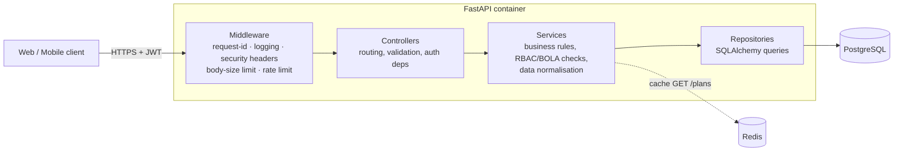
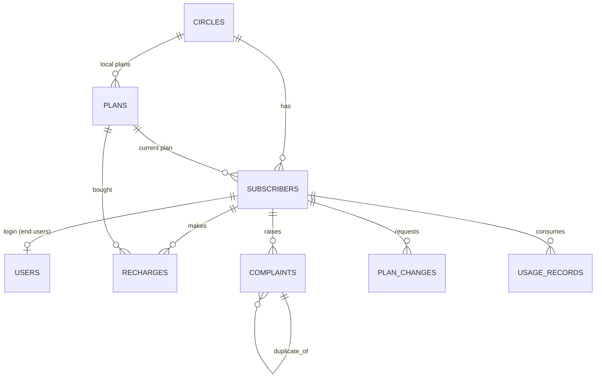

# Telecom REST API Backend

Backend for a **fictional Ahmedabad MVNO's prepaid plan comparison & recharge app**.
Python **FastAPI**, layered (controllers → services → repositories), PostgreSQL, Redis cache,
JWT auth with role-based access, Docker Compose, pytest suite with a ≥ 75 % coverage gate.

## Quick start

```bash
docker compose up --build            # API + PostgreSQL + Redis, demo data seeded
open http://localhost:8000/docs      # Swagger UI  (OpenAPI JSON at /openapi.json)
```

Run the tests (coverage gate fails the run below 75 %):

```bash
docker compose --profile test run --rm tests
# or locally:  pip install -r requirements-dev.txt && pytest --cov-fail-under=75
```

Export the OpenAPI spec to `docs/openapi.json`: `python scripts/export_openapi.py`

Demo logins (seeded; **change in any real deployment** via `SEED_*_PASSWORD` or disable with `SEED_ON_STARTUP=false`):

| user | password | role |
|---|---|---|
| `admin` | `Admin@12345` | admin |
| `staff` | `Staff@12345` | staff |
| `user1`..`user3` | `User@12345` | end user (linked to one subscriber) |

In Swagger: `POST /api/v1/auth/login` → copy `access_token` → **Authorize**.

## Architecture



| Layer | Folder | Responsibility |
|---|---|---|
| Controllers | `app/controllers` | HTTP only: routes, query/body schemas, `Depends` for auth & pagination |
| Services | `app/services` | Business rules, ownership checks, cleaning logic (`normalizers.py`), caching |
| Repositories | `app/repositories` | All SQL; whitelisted sorting, escaped LIKE, pagination |
| Schemas | `app/schemas` | Pydantic request/response models (input validation, no mass-assignment) |
| Core | `app/core` | config, JWT/bcrypt, error handling, JSON logging, middleware, cache |

## Database schema



Key design choices: money as integer rupees; usage always stored in **MB** (raw value+unit kept for audit);
`plans.circle_id NULL` = national plan; soft deletes for plans/subscribers to preserve history; CHECK constraints
(`price > 0`, `validity > 0`); indexes on every FK/filter column plus composites
`(active, price_inr)`, `(subscriber_id, created_at)`, `(subscriber_id, recorded_on)`.

## Endpoints (29 operations)

| Area | Endpoint | Access |
|---|---|---|
| Auth | `POST /auth/register`, `POST /auth/login`, `GET /auth/me`, `POST /auth/users` | public / public / any / admin |
| Circles | `GET /circles`, `POST /circles` | public / admin |
| Plans | `GET /plans` (search, filter, sort, paginate, cached), `GET /plans/compare?ids=1,2,3`, `GET /plans/{id}`, `POST`, `PUT /{id}`, `DELETE /{id}` | public reads / admin writes |
| Subscribers | `GET /subscribers`, `GET /subscribers/me`, `GET /{id}`, `POST`, `PUT /{id}`, `DELETE /{id}` | staff / user / own-or-staff / staff / staff / admin |
| Usage | `POST /subscribers/{id}/usage`, `GET /subscribers/{id}/usage` | staff / own-or-staff |
| Recharges | `POST /recharges`, `GET /recharges` | own-or-staff |
| Complaints | `POST /complaints`, `GET /complaints`, `GET /complaints/{id}`, `PATCH /complaints/{id}/status` | own-or-staff / staff |
| Plan changes | `POST /plan-changes`, `GET /plan-changes` | own-or-staff |
| Ops | `GET /health` | public |

All under `/api/v1` except `/health`. Lists accept `page` and `size` (max 100) and return
`{items, total, page, size, pages}`. Errors always look like
`{"error": {"code", "message", "request_id", "details"}}`.

## Handling the "messy" data

| Messy case | Where it is handled | Behaviour |
|---|---|---|
| Ported-out subscribers still marked active | `normalizers.reconcile_status`, used by seed + create/update | a past `ported_out_at` forces `status = ported_out`; recharges/plan changes are then rejected (409) |
| Duplicate complaints from app and call centre | `normalizers.find_duplicate`, `ComplaintService.create` | same subscriber + category within 24 h of a still-open complaint → stored with `duplicate_of_id` pointing at the original (never a chain) |
| Data usage in MB and GB mixed | `normalizers.normalize_usage_to_mb`, `UsageService.record` | everything stored in MB, `raw_value`/`raw_unit` retained; summary returns MB and GB |

The seed (`app/db/seed.py`) deliberately injects all three kinds of dirty rows and reports how many were fixed.

## Security (OWASP API Security Top 10, 2023)

| Risk | Mitigation |
|---|---|
| API1 Broken object-level authorisation | `services/access.py`: end users are pinned to their own subscriber on every read/write/list; tested for each resource |
| API2 Broken authentication | bcrypt hashing, JWT with pinned algorithm + mandatory `exp`/`sub`, generic login error + dummy hash (no user enumeration), strict login rate limit, password policy |
| API3 Broken object property-level authorisation | separate In/Out schemas, `extra="forbid"` (no mass-assignment: `role`, `balance_inr` not client-settable), password hash never serialised |
| API4 Unrestricted resource consumption | rate limiting (429 + `Retry-After`), page size ≤ 100, body size limit, bounded `ids` for compare, DB pool limits |
| API5 Broken function-level authorisation | `require_admin` / `require_staff` dependencies; role read from DB on every request (demotion is immediate) |
| API6 Unrestricted access to sensitive flows | recharge/plan-change state checks (active subscriber, active plan, circle match) |
| API7 SSRF | no outbound URL fetching |
| API8 Security misconfiguration | security headers + CSP, no stack traces to clients, CORS off unless configured, non-root container, secrets via env |
| API9 Improper inventory management | versioned `/api/v1`, OpenAPI is the single source of truth |
| API10 Unsafe consumption of APIs | no third-party APIs consumed; payment gateway is simulated |

SQL injection: SQLAlchemy parameterised queries only; LIKE wildcards escaped; sort columns whitelisted.

Production notes: set a strong `JWT_SECRET`, terminate TLS in front, put the API behind a proxy that sets the
real client IP, and move the in-memory rate limiter to Redis if you run several replicas.

## Testing

`tests/` has 91 test functions across happy paths **and** failure paths: validation (422), auth (401/403), BOLA,
conflicts (409), not-found (404), rate limiting (429), oversize body (413), sanitised 500 / DB outage (503),
cache hit/miss/invalidation/Redis-outage, data-cleaning rules and seed integrity.
Tests run on in-memory SQLite (no Docker needed); coverage is enforced with `--cov-fail-under=75`.

## Load testing (stretch)

```bash
RATE_LIMIT_PER_MINUTE=1000000 docker compose up -d --build   # per-IP limit would otherwise throttle k6
k6 run loadtest/k6_plans.js
```

`loadtest/k6_plans.js` simulates IPL-season traffic on `GET /api/v1/plans`: 200 req/s steady for 2 min, then a
spike to 400 req/s. Thresholds: p95 < 300 ms and < 1 % errors at 200 req/s. The plan list is cached in Redis
(60 s TTL, invalidated on any plan write); the response header `X-Cache: HIT|MISS` shows what happened.
Record your own k6 summary in `docs/` before submitting.

## Deliverables checklist

- [x] Source repository (this folder)  - [x] OpenAPI (`/openapi.json`, export script)  - [x] Postman collection (`postman/`)
- [x] Test suite + coverage gate  - [x] Dockerfile + Compose (API, PostgreSQL, Redis)  - [x] README with architecture diagram

## Interview prep: design & security answers

* **Why layered?** Controllers stay thin, business rules are unit-testable without HTTP, and SQL lives in one place.
* **Why soft delete?** Recharges, complaints and usage reference plans/subscribers; hard deletes would orphan audit history.
* **Why store usage in MB?** One canonical unit makes sums/comparisons correct; raw value+unit are kept for audit.
* **Why role from DB, not the token?** Revocation/demotion applies instantly without waiting for token expiry.
* **Why can the API run without Redis?** Cache is an optimisation; failures degrade to a miss, never an outage.
